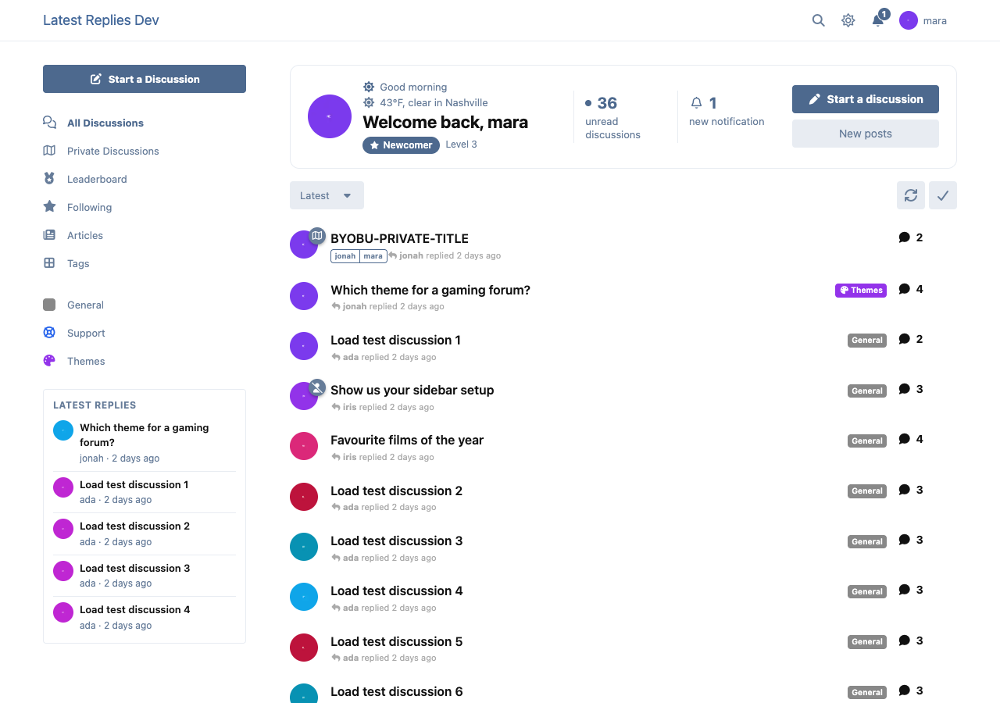
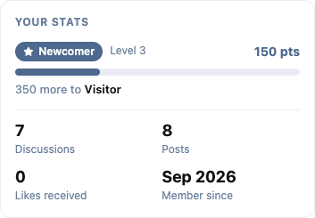
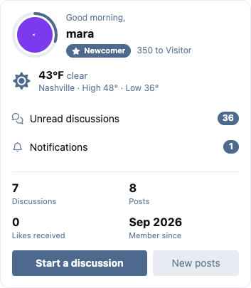

# Homecoming

A welcome-back dashboard for your members on Flarum 2: a greeting with their local weather, their unread discussions and new notifications, their rank and how far they are from the next one, and the stats you choose. As a strip above the discussion list, or as pieces you place with FoF Widgets, Page Builder or Bespoke.

 [](https://packagist.org/packages/ernestdefoe/homecoming)



- **Three pieces.** The **welcome strip** (greeting, name, avatar, rank or group, unread discussions and notifications, Start a discussion and New posts), the **stats card** (points and the bar to the next rank, then four stats) and the **compact card** (all of it in one small block for a sidebar; the rank progress is a ring around the avatar).
- **Rank and points** from [Renown](https://ernestdefoe.online/downloads/f/renown), else [Ladder](https://ernestdefoe.online/downloads/f/ladder), else [FoF Gamification](https://github.com/FriendsOfFlarum/gamification). With none of them, the bar isn't shown and the member's top group is.
- **Four stats you choose:** discussions, posts, likes received, best answers, collections ([Curio](https://ernestdefoe.online/downloads/f/curio)), badges ([FoF Badges](https://github.com/FriendsOfFlarum/badges)), points, level, member since. One that needs an extension you don't have is replaced by the next that works.
- **Weather where they are.** Members tap **Use my location** beside the weather (their browser asks only then), pick a town in their settings, or Homecoming uses their [Member Map](https://ernestdefoe.online/downloads/f/member-map) place, then the forum's default town. The forum fetches the forecast from [Open-Meteo](https://open-meteo.com) in the background, at most once every 30 minutes per area (about 10 km), so a page never waits on it and the member's browser never calls anyone else. Only rounded coordinates leave the browser and the forum (about a kilometre for the town name, about 10 km for the forecast), and only the town is kept. °C or °F, per member. Switch the weather, or just the location button, off in the admin.
- **Unread** means what Flarum means (not read to the last reply, newer than "mark all as read"), for discussions from the last 30 days (you can change it), without private or ignored ones.
- **Guests** see nothing, or a sign-up nudge if you turn it on.
- **Placed where you want.** The strip sits above the discussion list on its own. With [FoF Widgets](https://github.com/FriendsOfFlarum/forum-widgets-core), [Page Builder](https://ernestdefoe.online/downloads/f/page-builder) or [Bespoke](https://ernestdefoe.online/downloads/f/bespoke) you can place any piece, and the built-in strip steps aside while one is on the page.
- **Light.** Nothing is added to page loads or to guests. Each member's numbers are one small request after the page draws, kept for two minutes. The pieces are a separate file loaded only when one is shown.

 

## Install

```sh
composer require ernestdefoe/homecoming
```

## Update

```sh
composer update ernestdefoe/homecoming
php flarum cache:clear
```

## Links

- [Packagist](https://packagist.org/packages/ernestdefoe/homecoming)
- [GitHub](https://github.com/ernestdefoe/homecoming)
- [Buy me a coffee](https://buymeacoffee.com/ernestdefoe)
